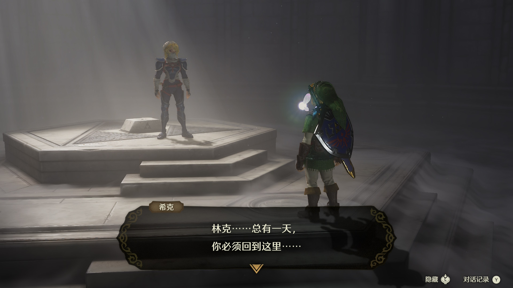
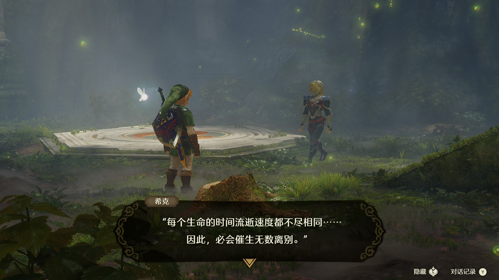

我第一次知道《时之笛》是 2012 年，我即将成年的高三暑假。

当时有同学刚买了一台 3DS，一次桌游聚会，我第一次摸到了这台游戏机，《时之笛3D》算是它的护航作。

当时的我还不知道，我要到 2015 年的暑假，才会拥有自己的 3DS，我将花几个小时尝试《时之笛3D》，但会因日版卡带没有中英文选项而卡关、弃坑。

2012 年，距离最初的 N64 版《时之笛》发售，已过去两个七年。一转眼，又是两个七年过去了，NS2 版《时之笛》重置发售。

2026 年 11 月 5 日，这一天恰好是我 32 岁的生日。我坐在沙发上，启动游戏。当经典的标题页出现在电视机上，旋律响起，眼泪汹涌而出。

「七年」是一个微妙的时间跨度。一种流行观点认为，「七年」是足以衡量人生的基本尺度，人的生活在七年间，往往会有质变。基于这一设定，有英国著名纪录片《人生七年》，以及 2016 年 Lucas Graham 出过一首热门歌曲《7 Years》。

游戏里，时之勇者林克反复在「七年」的跨度里来回穿越。现实里，《时之笛》已经跨越了 4 个七年的漫长时光。我知道这句话已经被说烂了，但：

> 人的一生，又有多少个七年？

-

《时之笛》是一部经典，是史上最伟大的游戏，这是全球玩家的共识。它是字面意义上的，3D 动作游戏的「万物起源」。

进入重制版，我的第一感受是：它的核心动作系统被打磨得更好了。操控林克，即便只是跑来跑去、跳进水坑，在草丛里打滚……体验也令人愉悦。

纵向上，与《时之笛3D》相比，这一体验显然是革新的；横向上，大部分现代动作 3A，因为系统、美术的复杂，也很难做到如此跟手、灵活。

《时之笛》重制版以追求「原汁原味」为宗旨，保留了八成以上的内容不变，只对细节进行了调整，而没有像《FF7:RE》那样彻底推倒重来。

无人质疑任天堂偷懒，但这一切可行的前提依然是：它的内容要足够经得起时间考验。

历史上有很多经典游戏，如《FF7》、《DQ3》，包括初代的《塞尔达传说》，它们都是开创了一个类型的里程碑式作品。但随着类型发展，用后来的视角去看，不免会觉得有点太简陋，很难玩下去。

我 2015 年第一次接触《时之笛3D》的时候就有类似感觉：画面太过时了。要知道那年春天我刚玩过次世代版的《GTA5》。所以当时我只玩到德库树就弃坑了，要到两年后的春天，我才第一次通关《荒野之息》，完成了我的「塞尔达启蒙」。

但《时之笛》重制版证明了，它内容本身丝毫不过时，不会因为你玩过很多现代游戏就失去乐趣。恰恰相反，你玩过的游戏越多，就越会感叹《时之笛》的系统、谜题设计是多么经典。

最能证明这一点的关卡，无疑是「水之神殿」。

过去十几年里，我反复听朋友说这是一个有难度，但又无比巧妙的关卡。所以我忍住了没看任何攻略内容，以完全「初见」的状态体验了它。

实际玩下来，重制版的「水之神殿」并不难，攻略过程非常流畅。可能是我已有了太多 3D 解谜的经验。并且，随着画面升级，想在脑海里构建整个迷宫的空间结构也变得更简单，完全不会迷路。

全作通关后，我依然震撼于「森」、「水」、「魂」之神殿，这三个迷宫的精妙，就像是一个制作人玩遍了所有的好游戏，萃取其精华，做出来的关卡。

但实际上，这些关卡全都是宫本茂在没有任何先例的时代，从零开创的。后来的一切游戏，才是模仿者。

-

《时之笛》游玩过程中，最令人意外的体验，是「难度」。

它远没有我印象里那么难。早期固然是有点缺乏引导，那些需要吹陶笛、掏道具推进的任务，不看攻略，很难靠自己摸索出来。但迷宫内的解谜、战斗、BOSS，都不难。全通后看 Zelda’s Note，我惊讶发现，自己全程竟然只 Game Over 了两次。

现在回想，2015 年我玩《时之笛3D》的时候，之所以畏难，主要在于：我们这代人从小是玩 PC 长大的，也就是韩式 RPG 和暴雪游戏。这些游戏基本是围绕数值设计的 RPG，我们因此过度接受了这种「通过数字形式的属性计算，衡量自机与敌人间战斗关系」的设定。没有数字辅助，我们就下意识觉得那些怪物「不可战胜」。

但《塞尔达传说》不是数值游戏。三角之力里，盖侬多夫象征「力量」，林克和塞尔达则分别象征「勇气」和「智慧」，这个系列的内核就是：

> 通过鼓起勇气，冷静观察，发现弱点，成功挑战那些看起来难以战胜的魔物。

《时之笛》有不少恐怖元素，无论是德库树的蜘蛛、墓地的僵尸、井底的死手，都压迫着玩家的心理防线。也正因如此，当你挑战成功后，那种喜悦和成就感才变得如此真实。后来这招被宫崎英高学到了精髓，并发扬成了当下最火的游戏垂类。

我不反对数值设计本身，电子游戏离不开数值。但很显然，通过数字衡量属性的设定，反映的是一种消费主义的文化。这种文化被推向极致之后，出现了 pay2win，一切被简化为一个数字——「战斗力」。

这也是为什么，对我们这代小孩来说，第一次通关一部《塞尔达传说》几乎是一种直击灵魂的 detox 体验，是一种永久的 life-changing。

因为「数值」的毒性存在于生活的方方面面。我们的人生就是被量化的，被分数、金钱量化，买手机要「不服跑个分」，连长相都被称为「颜值」。

后来，我不断回到 2017 年的春天，就是因为我知道，在通关《荒野之息》的时候，我身体里有一些最宝贵的东西被点亮了。

-

内容保持原汁原味，《时之笛》重制的重点就成了「视听体验」。

画面上，团队继承了《荒野之息》、《王国之泪》的次世代美术经验，同时也有更进一步的升级。它距离当下前沿 3A 的画面当然有差距，但整个氛围的梦幻、童话感，足够服务于内容，这一点我觉得无需赘述。

更容易被忽略的点，是音乐。

N64 时代，游戏机已有声卡，可以播放采样的真实音乐，不再受限于 8-bit 音色。但因为卡带容量的限制，《时之笛》只能采样很短的声音片段，近似于一个个不同音色的音符，靠内置的乐谱系统，实时合成出音乐。

重制版对音乐进行了彻底的重新制作，加入更多管弦乐团的真实演奏。这一点从进入标题页就能听出来，钢琴、弦乐、笛声的音色质感，变得更悠扬而富有深度。

这恰好呼应了「时之笛」的设定。在游戏推进的过程中，你将学会用陶笛吹奏 12 首乐曲。游戏内的陶笛只有五个音符，对应到 C 大调上分别是 D、F、A、B、D。林克吹奏的，只是旋律的最基本构成，即 motif。motif 扩展成完整旋律，再进行编曲制作。

任天堂早期的游戏音乐，基本由近藤浩志一个人操刀。他最大的天才之处，就是创造了这种工程化的作曲方法，写出了那些经典的 motif。

从最早的 8-bit 音乐，到 N64 时代的合成音乐，再到今天的真实管弦制作……基本构成没变过。像伊波那之歌、塞尔达摇篮曲、时之歌，这些旋律的变奏、重编曲版本，被用在后来的几乎每一部《塞尔达》里。

而玩家，因为在游戏里反复演奏过这几个音符，即便没有任何音乐基础，也会记住这些旋律构成。当它们时隔多年，再次出现，才会立即击中我们的泪腺和内心。

-

《时之笛》里，我最喜欢的支线，是学习「风暴之歌」这一段  。

当童年林克第一次来到卡卡利科村时，还不会吹奏「风暴之歌」。直到七年后，成年林克来到这里，磨坊大叔才会教你这首曲子，同时他会告诉你，七年前有个妖精小鬼在这里吹了这首曲子……提示你要穿越回过去，吹响「风暴之歌」，解开井底之谜。

类似的设计在游戏里还有两处。包括海拉鲁城邑旁的小贩果，要用成年林克先通过妖精标记找到暗号，再用童年林克去对暗号，买走心之碎片。如果直接用成年林克去找小贩果，小贩果会说心之碎片已经被小孩买走了。

这很容易让人联想到 Ted Chiang 的小说《Story of Your Life》，后来被改编成维伦纽瓦的电影《降临》。它的设定颠覆了时间的「单向线性」，阐述了一种新的时间观：过去、当下和未来并存，是一个整体。因果也不再是前后逻辑，而是变成了一个「钳形」结构，人无法改变已注定的命运，但可以弥补过去的遗憾。

去年春天，我去了京都的醍醐寺赏樱。这是我初中时代就在书上读到的樱花名所。透过照片，那些樱花盛开的景象，被刻在脑海里。17 年后，坐在飞往关西的飞机上，朋友问：「如果不是最完美的满开状态，会遗憾吗？」

我说：

> 其实这些樱花在我 13 岁的时候就已经开过了，如今亲身来到这里，只不过是种下使它逆着时间向前生长的种子而已。

这正是对《时之笛》概念本身最好的诠释。2012 年，当我第一次听到《时之笛》这个名字的时候，我并不知道自己会在三年后错过《时之笛3D》，要等到两个七年后的今天，才终于回收伏笔。

通关的那天夜里，我好像梦见了 2012 年，回到了我的「笛之时」，梦里我说：

> 我完成了这段因果。

-

最后，《时之笛》的结局，也蕴含着本作最深刻的表达。

时之勇者击败加侬多夫，贤者们封印灾厄。塞尔达将林克送回童年，找回失去的七年时光。但代价是，他们将未曾相见。

是的，成为时之勇者，来回穿越时间，怎么可能没有代价呢？无论是前往未来还是回到过去，它就像每个人的成长，必然伴随着失去。

希克第一次见到林克时就说：

> 每个生命的时间流速都不尽相同……因此，必会催生无数离别。

随年龄增长，你越来越意识到，人注定是被磨损的。并不存在一种方法，可以把散佚在时间中的生命本质，重新萃取出来。

正如张爱玲的金句：「世钧，我们回不去了」，也如《一一》里杨德昌借 NJ 之口的感叹：「只是突然觉得，再活一次的话，好像真的没那个必要。」

从小到大，每隔一段时间，我都觉得自己已变得成熟、完整，「感觉自己以后不会再变了」。但每过一段时间再回头看，显然一切都会变，连记忆都变得遥远。

七年前，2019 年末尾的时候，我曾说：

> 我希望人生中经历的很多东西是连贯的，从前的「因」和未来的「果」，能够形成一种凝聚起来的东西。到这里，我觉得我做到了。

我还不知道，紧接着而来的，会是怎样的灾厄，时代和生命会如何碎裂并散落。这一切，显然无法被一部《时之笛》修复。

但希克也说：

> 然而……也有时间难以磨灭之物。那便是儿时彼此陪伴所留下的追忆。

> 总有一天，你必须回到这里。

在一个万事万物都有赏味期限的时代里，《时之笛》让我们确信，有一些东西能贯穿人生始终。这种混杂着喜悦与惆怅的心情，关于时间的顿悟，将成为一种永恒的生命体验。

下一次笛声响起的时候，我们又会回到一切的开始，作为林克，再次醒来。